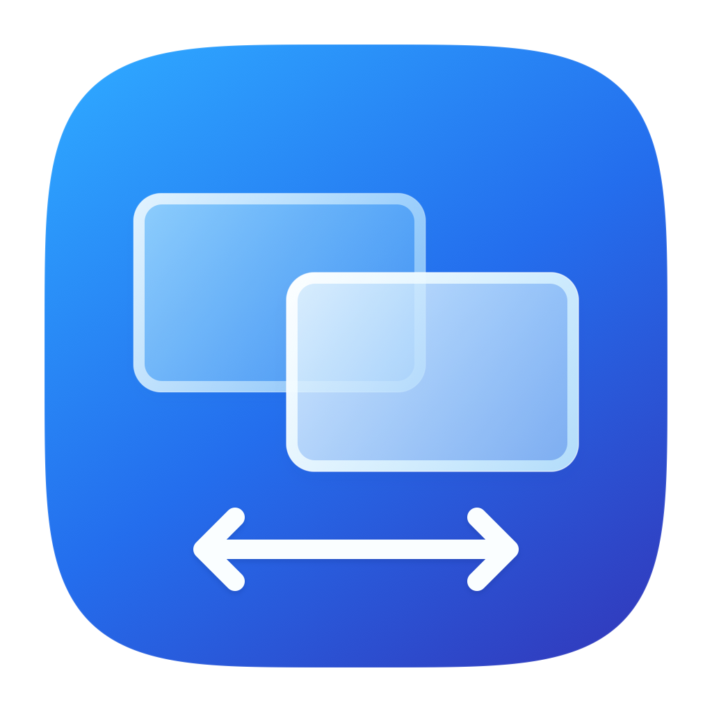
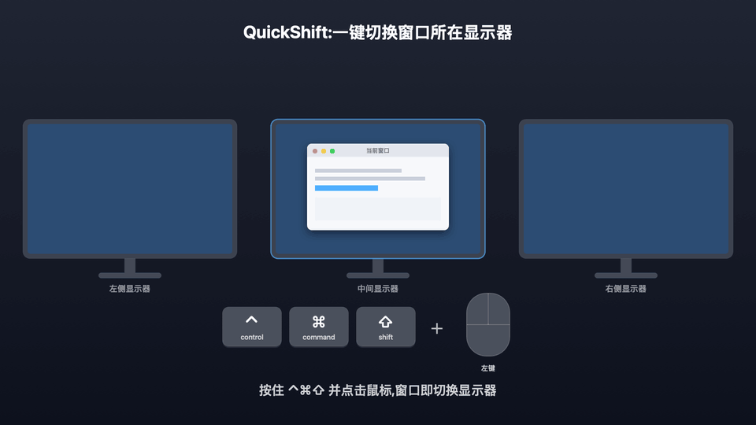

<!-- HEADER_ICON_START -->
<p align="center">
  
</p>
<!-- HEADER_ICON_END -->

<h1 align="center">QuickShift</h1>

<p align="center">
  <a href="README.md">English</a> · <a href="README.zh-CN.md">简体中文</a>
</p>

<!-- TOOL_PHILOSOPHY_START -->
<p align="center"><strong>让跨屏幕挪动窗口不再成为负担。</strong></p>
<!-- TOOL_PHILOSOPHY_END -->

<!-- SHORTCUT_PHILOSOPHY_START -->
<p align="center">
  默认 <strong>Control + Command + Shift + 鼠标左／右键</strong><br>
  不易与系统或其他应用的快捷键冲突，直观、顺手、高效。
</p>
<!-- SHORTCUT_PHILOSOPHY_END -->

<p align="center">原生 macOS 菜单栏工具，用快捷键将当前活动窗口移动到另一台显示器。</p>

<p align="center">
  
</p>

<p align="center">
  <a href="#用户指南">用户指南</a> · <a href="#开发者指南">开发者指南</a> · <a href="#故障排查">故障排查</a>
</p>

## 用户指南

### 功能

- 向左或向右移屏，操作当前活动窗口，鼠标可停在任意位置。
- 为两个方向分别设置「修饰键 + 鼠标按钮」或键盘快捷键。
- 开启循环以轮换显示器，或关闭循环以在边缘停止。
- 尽量保留窗口尺寸和相对位置，并适配较小显示器的可用区域。
- 通过菜单栏暂停快捷键、修改设置或退出。
- 重启后恢复快捷键开关状态，并可选择登录时启动。

### 安装

需要 **macOS 13 或以上**，以及至少 **两台处于扩展模式的显示器**。镜像显示共享同一工作区，不提供独立的移屏目标。

- **应用包安装：**从本仓库的 **Releases** 页面下载通用 ZIP，解压后将 `QuickShift.app` 移到「应用程序」文件夹。签名和公证状态见对应的发布说明。
- **从源码安装：**先[构建应用](#从源码构建)，再将 `dist/QuickShift.app` 移到「应用程序」文件夹。

从最终安装位置打开 QuickShift，再授予权限。

### 快速开始

1. 在 QuickShift 中点击「打开辅助功能设置…」，在 macOS 系统设置中为 QuickShift 开启权限。
2. 在 QuickShift 设置中勾选「启用全局快捷键」。
3. 激活一个普通应用窗口，使用下方的默认快捷键。

### 默认快捷键

| 操作 | 快捷键 |
| --- | --- |
| 移到左侧显示器 | Control + Command + Shift + 鼠标左键 |
| 移到右侧显示器 | Control + Command + Shift + 鼠标右键 |

快捷键移动**当前活动窗口**。命中的点击会被拦截，避免激活鼠标下方的应用或打开右键菜单。

**默认开启循环：**最左侧再向左会移到最右侧，反方向同理。

### 自定义快捷键与行为

点击菜单栏图标 →「设置…」。

1. 点击需要修改的方向对应的快捷键。
2. 按住一个或多个修饰键：Control、Option、Shift、Command，再按下键盘按键，或在录制区域点击鼠标按钮。
3. 点击「保存」。

两个方向必须使用不同的组合键。修饰键精确匹配，例如额外按住 Option 不会触发默认快捷键。Caps Lock、Fn 和数字键盘标志不参与匹配；键盘快捷键按物理键位保存。

关闭「循环切换显示器」后，在左右边缘停止移动。设置会自动保存。已获得辅助功能权限时，勾选快捷键开关会在下次正常启动后自动恢复监听；主动关闭后，重启仍保持关闭。关闭设置窗口后，QuickShift 继续在菜单栏运行；需要结束进程时，请使用菜单中的「退出 QuickShift」。

### 登录时启动

在设置中开启「登录时启动」，macOS 会在你登录时打开 QuickShift；关闭该选项即可移除登录项。默认不开启，与全局快捷键开关相互独立。

如果 macOS 要求批准，点击「打开登录项设置…」并允许 QuickShift。应用显示的状态以 macOS 为准，也会反映你在系统设置中所做的修改。

### 窗口移动规则

- 按 macOS 中的显示器位置从左到右排序；水平中心相同的显示器按从上到下排序。
- 窗口跨越多台显示器时，以覆盖面积最大的显示器作为起点。
- 尽量保留窗口尺寸和相对位置。支持缩放的窗口可缩小以适配目标屏幕的可用区域，避开菜单栏和 Dock。
- 自动识别显示器连接和排列变化。
- macOS 原生全屏窗口需要先退出全屏再移动。QuickShift 操作桌面窗口，不切换 Space。

### 权限与隐私

QuickShift 通过**辅助功能权限**控制窗口，不需要屏幕录制权限，不发送网络请求，也不记录输入的按键内容。偏好设置保存在本机。

关闭快捷键会移除全局输入监听。全新安装默认关闭，之后按已保存的选择恢复。诊断或保护性暂停会保留该选择，可通过「重新启动监听」恢复。Command + Option + Esc 始终保留给系统强制退出。

## 开发者指南

### 从源码构建

需要带有 **Swift 6** 的 Xcode 或 Command Line Tools。项目使用 Swift Package Manager，没有第三方依赖；可在 Xcode 中打开 `Package.swift`，也可在仓库根目录执行：

```bash
bash scripts/build-app.sh
open dist/QuickShift.app --args --paused
```

脚本默认按当前 Mac 的架构构建 release 应用，打包资源并签名，输出至 `dist/QuickShift.app`。

重新构建同一路径前，请先从 QuickShift 自己的菜单退出已有实例。关闭设置窗口不会结束进程。

### 构建选项与签名

构建同时支持 Apple Silicon 与 Intel 的通用应用：

```bash
bash scripts/build-app.sh --arch arm64 --arch x86_64
```

| 环境变量 | 默认值 | 用途 |
| --- | --- | --- |
| `CONFIGURATION` | `release` | Swift 构建配置，例如 `debug` 或 `release`。 |
| `QUICKSHIFT_APP_PATH` | `<repository>/dist/QuickShift.app` | 应用输出位置；自定义位置请使用绝对路径。 |
| `SIGNING_IDENTITY` | Git 配置 `quickshift.signingIdentity`，未设置时为 `-` | 为本次构建指定签名身份。 |
| `QUICKSHIFT_ALLOW_IDENTITY_CHANGE` | `0` | 有意更换为不兼容的签名身份时，设为 `1` 以替换旧版。 |

#### 更新后保留辅助功能授权

本机自用可在 Xcode 设置 → 账户 → 管理证书中创建 **Apple Development** 证书。准备在 Mac App Store 之外公开分发时，使用 Apple Developer Program 团队的 **Developer ID Application** 证书。选定今后沿用的签名类型，从第一条命令的输出复制完整身份名称，在当前仓库配置一次即可。

```bash
security find-identity -v -p codesigning
git config --local quickshift.signingIdentity 'Apple Development: Your Name (ID)'
bash scripts/build-app.sh
```

macOS 按应用的代码身份记录辅助功能授权。日常更新请沿用 Bundle ID、签名身份及安装位置。打包脚本会按新旧两版各自的签名要求双向校验，兼容后才替换旧版。身份不兼容时会保留原包。并行测试可运行 `QUICKSHIFT_APP_PATH="$PWD/dist/preview/QuickShift.app" bash scripts/build-app.sh` 生成单独的产物。[Apple 关于代码身份与隐私授权的说明](https://developer.apple.com/documentation/technotes/tn3127-inside-code-signing-requirements)

已安装的 ad hoc 版本，其授权绑定到那次构建的代码哈希。首次迁移到已配置的证书时，从菜单退出 QuickShift，运行 `QUICKSHIFT_ALLOW_IDENTITY_CHANGE=1 bash scripts/build-app.sh`，再为新身份授予一次辅助功能权限。之后构建会沿用保存的身份。Developer ID 构建会启用强化运行时和安全时间戳。公开分发如需通过标准 Gatekeeper 检查，还需单独提交 Apple 公证。[Apple 公证指南](https://developer.apple.com/documentation/security/notarizing-macos-software-before-distribution)

### GitHub Releases

[发布工作流](.github/workflows/release.yml)仅支持手动触发。将配置推送到仓库默认分支后，打开 **Actions → Build and release → Run workflow**。工作流必须先存在于默认分支，GitHub 才会显示手动运行入口。[GitHub 手动运行工作流说明](https://docs.github.com/en/actions/how-tos/manage-workflow-runs/manually-run-a-workflow)

| 参数 | 行为 |
| --- | --- |
| `source_ref` | 要打包的提交 SHA、分支或标签。建议填写完整提交 SHA；留空时构建所选工作流分支在触发时的提交。 |
| `release_tag` | 新标签，例如 `v1.2.1` 或 `v1.2.1-rc.1`。版本部分必须与所选提交中 `Resources/Info.plist` 的 `CFBundleShortVersionString` 一致。 |
| `signing` | `ad-hoc` 无需 Apple 凭据；`developer-id` 使用下方 Secrets 完成证书签名和公证。 |
| `draft` | 附件齐全后保留为草稿，不立即公开发布，默认关闭。 |
| `prerelease` | 标记为预发布，默认关闭；标签后缀不会自动开启此选项。 |

工作流会测试所选源码，构建 Apple Silicon 与 Intel 通用应用，并生成以下 Release 附件：

- `QuickShift-<tag>-macOS-universal.zip`
- `SHA256SUMS.txt`
- `build-info.json`：记录完整源码提交、应用版本、架构、签名类型与工作流运行地址
- `release-notes.md`：同时作为 Release 正文

所有附件上传完成后才会公开发布。已有 Release 不会被替换；已有标签仅在指向所选提交时可用。发布新的应用版本前，先修改 `Resources/Info.plist` 中的版本号。工作流不会改写源码或移动标签。

默认分支上的常规发布使用内置 `GITHUB_TOKEN` 即可，仅发布任务申请 `contents: write` 权限。仓库或组织策略需要允许 GitHub Actions 及相应权限。发布脚本来自工作流所在提交，应用源码来自 `source_ref`。

若目标提交相对默认分支修改了工作流文件，GitHub 在创建 Release 或标签时可能要求工作流写权限。此时可选配置仓库 Secret `RELEASE_TOKEN`，使用仅限当前仓库的 fine-grained token，赋予 **Contents: Read and write** 和 **Workflows: Read and write** 权限，仅发布步骤使用它。[GitHub Release API 权限说明](https://docs.github.com/en/rest/releases/releases#create-a-release)

#### 可选的 Developer ID 签名与公证

使用 `developer-id` 类型时，在 **Settings → Secrets and variables → Actions** 添加下列**仓库级 Actions Secrets**。需要 Apple Developer Program 会员资格、包含私钥的 Developer ID Application 证书，以及具有公证权限的 App Store Connect 团队 API 密钥。

| Secret | 内容 |
| --- | --- |
| `MACOS_CERTIFICATE_P12_BASE64` | `.p12` 导出文件的 Base64 内容，其中必须恰好包含一个有效的 **Developer ID Application** 签名身份及其私钥。 |
| `MACOS_CERTIFICATE_PASSWORD` | 导出 `.p12` 时设置的非空密码。 |
| `APPLE_NOTARY_KEY_ID` | App Store Connect 团队 API 密钥 ID。 |
| `APPLE_NOTARY_ISSUER_ID` | API 密钥的 issuer ID。 |
| `APPLE_NOTARY_PRIVATE_KEY` | API 密钥 `.p8` 文件的完整内容，包含头尾标记。 |

签名任务会将证书导入临时钥匙串、提交 Apple 公证、将通过公证的票据装订到应用，再重新生成 ZIP 和校验值，结束后清理导入的凭据。后续更新应沿用同一签名类型和团队，保持应用身份一致。

默认 `ad-hoc` 类型跳过 Apple 证书签名与公证；macOS 可能要求手动批准打开，更新后也可能需要重新授予辅助功能权限。将所有附件下载到同一目录后，可执行校验：

```bash
shasum -a 256 -c SHA256SUMS.txt
```

### 测试

在仓库根目录运行 Swift 测试和原生看门狗检查。看门狗检查还需要 Python 3。

```bash
swift test
python3 scripts/test-watchdog.py
bash scripts/test-signing.sh
python3 -m unittest discover -s scripts/ci/tests -p 'test_*.py'
```

测试覆盖显示器导航与窗口放置、快捷键校验与保存、启动偏好、自身与外部窗口的处理路径、登录项状态、输入匹配及松开处理、看门狗恢复。Swift 测试使用内存事件和模拟登录项服务，看门狗检查运行于独立子进程；两者均不会安装事件过滤器或发送系统输入。

执行 `python3 scripts/test-watchdog.py --idle-cost` 可对空闲的输入引擎采样 30 秒。测试使用私有 Mach 端口，报告 CPU 占用、线程数和每秒上下文切换次数。

签名检查使用临时应用副本，验证兼容更新、签名身份不兼容或证书缺失时的拒绝行为，以及运行中程序的替换保护。

### 开发测试窗口

构建并打开用于跨进程移屏检查的独立窗口：

```bash
mkdir -p .build
bash scripts/build-window-probe.sh
open .build/QuickShiftProbe.app
```

窗口显示所在屏幕、坐标、尺寸和收到的输入事件数，并将状态写入 `.build/probe-state.json`。成功拦截快捷键时，窗口应移动，输入计数应保持不变。

如需将监听限制在测试进程，先退出 QuickShift，再将下方的 `12345` 替换为状态文件中的 `processID`：

```bash
open dist/QuickShift.app --args --test-target-pid 12345 --paused
```

在应用中启用快捷键后开始测试。此模式只接受 QuickShiftProbe 进程，无效目标不会退回全局监听。使用实体鼠标时，每次移屏后需将指针移到新的测试窗口，让后续点击仍落在其中；正常全局模式没有这一鼠标位置限制。

### 项目结构

| 路径 | 职责 |
| --- | --- |
| [`Sources/QuickShiftCore`](Sources/QuickShiftCore) | 显示器几何与导航、偏好设置和快捷键匹配。 |
| [`Sources/InputSafety`](Sources/InputSafety) | 原生事件线程、原子配置、动作队列和看门狗。 |
| [`Sources/QuickShiftDisplay`](Sources/QuickShiftDisplay) | AppKit 界面、登录项、自身窗口的主线程操作，以及外部窗口的辅助功能队列。 |
| [`Tests`](Tests) | Swift 测试与原生测试夹具。 |
| [`scripts`](scripts) | 应用及测试窗口构建、图标生成和看门狗检查。 |
| [`.github/workflows/release.yml`](.github/workflows/release.yml)、[`scripts/ci`](scripts/ci) | 手动触发的通用构建、发布打包、可选公证与 Release 发布。 |

`.build/` 和 `dist/` 中的编译产物与本机诊断文件不纳入 Git。维护规范见 [`AGENTS.md`](AGENTS.md)。

## 故障排查

| 问题 | 处理方式 |
| --- | --- |
| 窗口没有移动 | 确认辅助功能权限已开启、快捷键已启用、普通窗口已激活，并连接了至少两台扩展显示器。 |
| 替换应用后权限失效 | 确认签名身份并打开已安装的副本。有意更换身份后，请为新版开启辅助功能。若系统只显示旧授权，再移除旧的 QuickShift 条目并添加已安装的副本。参见[更新签名配置](#更新后保留辅助功能授权)。 |
| 已授权，但输入监听未就绪 | 如果设置中显示「检查输入监控…」，通过该按钮检查权限，再退出并重新打开应用。 |
| 开关已勾选，但监听处于暂停状态 | 查看设置中的状态，诊断或保护性暂停后可点击「重新启动监听」恢复。报告意外退出问题时，请附上[诊断报告](#诊断报告)。 |
| 登录时启动显示等待批准 | 通过 QuickShift 的「打开登录项设置…」在 macOS 中允许该应用。启动后，全局快捷键开关会单独按保存的选择恢复。 |
| 某个快捷键不触发 | 检查修饰键是否完全匹配，以及是否与系统快捷键或其他工具冲突。安全输入框可能限制事件访问。 |
| 全屏窗口或某个应用无法移屏 | 先退出原生全屏；目标应用必须通过 macOS 辅助功能接口提供可移动的窗口。 |
| 原本铺满的窗口没有铺满目标屏幕 | 移动后手动调整尺寸。自动扩展到目标屏幕的完整宽度或高度不作保证，应用自身也可能限制尺寸。 |
| 构建脚本提示 QuickShift 正在运行 | 从 QuickShift 菜单栏菜单退出，再重新构建。 |
| macOS 阻止打开应用包 | 默认构建使用 ad hoc 签名，未经过 Apple 公证。请根据具体提示参照 [Apple 的应用打开说明](https://support.apple.com/en-us/102445)。 |
| 找不到 **Run workflow** | 将发布工作流推送到仓库默认分支，并确认 Actions 权限。参见 [GitHub Releases](#github-releases)。 |
| 发布任务拒绝标签，或上次失败留下草稿 | 使用与所选应用版本一致的标签。已有标签时，所选提交必须与其一致。重试同一标签前先删除失败草稿，或改用新的版本后缀；已发布版本不会被覆盖。 |

### 诊断报告

如果应用安装在「应用程序」目录：

```bash
/Applications/QuickShift.app/Contents/MacOS/QuickShiftDisplay --diagnostics
```

源码构建则使用 `dist/QuickShift.app/Contents/MacOS/QuickShiftDisplay --diagnostics`。

报告包含显示器几何信息、最近记录的输入引擎状态、计数、回调耗时，以及可用时的上次保护性退出信息，不包含按键内容。`diagnosticProcessAccessibilityTrusted` 表示命令行进程的权限；正在运行的应用是否获权，请以其设置界面为准。

| 故障代码 | 含义 |
| --- | --- |
| `0` | 没有记录到保护故障。 |
| `1` | 输入回调停顿。 |
| `2` | 事件循环停顿。 |
| `3` | 待处理的移屏动作未交付至主循环。 |
| `4` | macOS 报告事件过滤器超时。 |
| `5` | 动作队列溢出。 |
